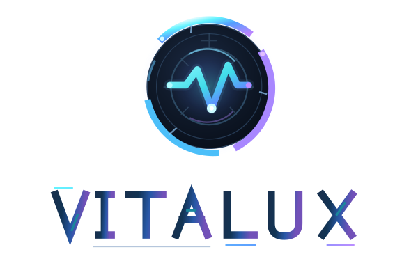
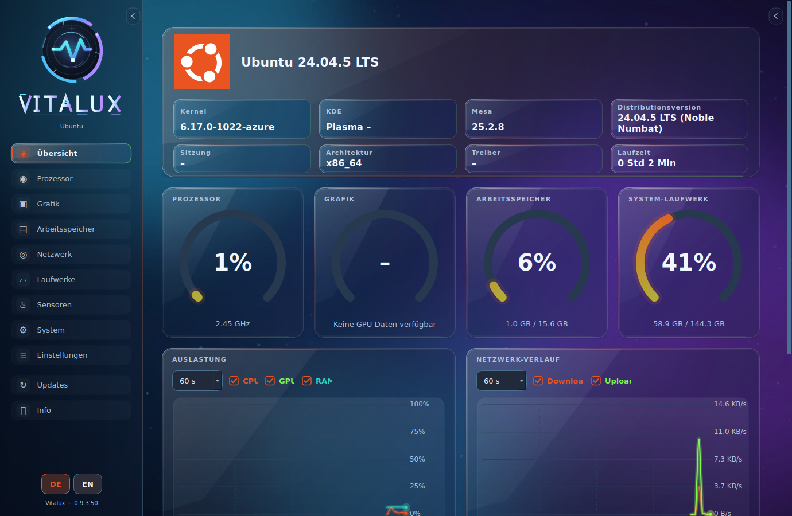

<p align="center">
  <picture>
    <source media="(prefers-color-scheme: dark)" srcset="assets/vitalux-readme-dark.svg">
    <source media="(prefers-color-scheme: light)" srcset="assets/vitalux-readme-light.svg">
    
  </picture>
</p>

<h3 align="center">Dein Linux-System. Alle wichtigen Informationen. Eine Anwendung.</h3>

<p align="center">
  Vitalux ist ein nativer Linux-Systemmonitor mit Live-Dashboard, Hardwareinformationen, Sensoren und integriertem Laufwerks-Benchmark.
</p>

<p align="center">
  <a href="https://github.com/PAAAUUULLOOOH/Vitalux/releases/latest"></a>
  
  
  
</p>

<p align="center">
  <a href="https://github.com/PAAAUUULLOOOH/Vitalux/releases/latest"><strong>⬇ Aktuelle Version herunterladen</strong></a>
  &nbsp;·&nbsp;
  <a href="#funktionen">Funktionen</a>
  &nbsp;·&nbsp;
  <a href="#installation">Installation</a>
  &nbsp;·&nbsp;
  <a href="#sprachen-und-integrierte-anleitung">Anleitung & Sprachen</a>
  &nbsp;·&nbsp;
  <a href="#updates">Updates</a>
  &nbsp;·&nbsp;
  <a href="#probleme-beheben">Hilfe</a>
</p>

---

> [!NOTE]
> **Vitalux befindet sich in der Entwicklung.** Welche Sensoren und Hardwarewerte verfügbar sind, hängt von der Distribution, den Treibern und den Zugriffsrechten ab.

<p align="center">
  
</p>
<p align="center"><sub>Vitalux-Dashboard im Glass-Design · Aufnahme auf einem Linux-Testsystem – angezeigte Werte variieren je nach Hardware.</sub></p>

## Funktionen

| Bereich | Funktionen |
| --- | --- |
| **Übersicht** | Anpassbares Live-Dashboard mit Systemdaten, Kacheln und Diagrammen |
| **Prozessor & Grafik** | Auslastung, Takt, GPU-/CPU-Informationen und verfügbare Sensorwerte |
| **Arbeitsspeicher & Netzwerk** | RAM und Swap, Schnittstellen sowie Download- und Uploadraten |
| **Laufwerke** | Partitionen, Speicherbelegung, SMART-Daten und Laufwerks-Benchmark mit `fio` |
| **Sensoren & System** | Temperaturen, Lüfter, Spannungen, Distribution, Kernel und Systemumgebung |
| **Einstellungen** | Akzentfarben, Animationen, Messintervalle und Dashboard-Anordnung |
| **Updates & Info** | Automatische Versionsprüfung, Aktualisierung auf Wunsch und integrierte Anleitung |

**Farbschemata:** Dark, Light, Glass, Black Glass und Minimalistisch. Glass und Black Glass bieten Glasoptik mit weichgezeichnetem Hintergrund. Die Dropdown-Menüs passen sich farblich an das gewählte Design an. Eigene Akzentfarben kannst du benennen und speichern. Wähle eine gespeicherte eigene Farbe aus, um sie über **„Bearbeiten“** umzubenennen oder neu einzufärben und über **„Löschen“** zu entfernen. Beide Schaltflächen erscheinen nur bei eigenen Farben.

**Hardware-Warnungen:** In **Einstellungen → Hardware-Warnungen** aktivierst du Grenzwerte. Die kompakten Eingabefelder für CPU-/GPU-Temperatur, RAM-Auslastung und Systemlaufwerk stehen rechts hinter ihren Beschriftungen.

**Laufwerks-Benchmark:** Sequenzielle und zufällige Lese-/Schreibtests mit anpassbaren Testprofilen. Angezeigt werden unter anderem **MB/s** (Datenrate), **IOPS** (Ein-/Ausgabevorgänge pro Sekunde) und **Latenz** (Verzögerung).

> [!CAUTION]
> Laufwerks-Benchmarks erzeugen echte Schreibzugriffe und benötigen freien Speicherplatz. Wähle das Ziel sorgfältig und sichere wichtige Daten vorher.

### Sprachen und integrierte Anleitung

Vitalux unterstützt **Deutsch und Englisch**. Über die Schaltflächen **DE / EN** unten in der Seitenleiste kannst du die Sprache direkt wechseln, ohne die App neu zu starten.

Unter **Info → Anleitung öffnen** findest du eine **interaktive Anleitung mit neun Seiten**. Pfeile, Markierungen und eine beispielhafte Vitalux-Oberfläche erklären die Funktionen Schritt für Schritt. Beim ersten Start wird die Einführung optional angeboten; sie bleibt später jederzeit im Info-Reiter erreichbar.

## Download

**[➡️ Neueste Vitalux-Version auf GitHub Releases](https://github.com/PAAAUUULLOOOH/Vitalux/releases/latest)**

Öffne bei der neuesten Veröffentlichung den Bereich **Assets**:

| Download | Verwendung |
| --- | --- |
| **`Vitalux-vVERSION-x86_64.AppImage`** | **Empfohlen:** Direkter Start oder Integration ins Anwendungsmenü |
| `Vitalux-vVERSION-linux-x86_64.zip` | Vollständige Version zum Entpacken und Starten |
| `Vitalux-vVERSION-SHA256SUMS.txt` | Prüfsummen zur Überprüfung der Downloads |

`VERSION` steht für die jeweils aktuelle Versionsnummer.

## Installation

### AppImage – empfohlen

1. Lade das aktuelle **AppImage** unter [Releases](https://github.com/PAAAUUULLOOOH/Vitalux/releases/latest) herunter.
2. Erlaube im Dateimanager die Ausführung der Datei – bei **KDE Dolphin** unter **Eigenschaften → Berechtigungen**.
3. Öffne das AppImage per **Doppelklick**.
4. Beim ersten Start wählst du **„Jetzt installieren“** oder **„Nur einmal starten“**.

Bei der Installation wird Vitalux für deinen Benutzer ins Anwendungsmenü integriert – normalerweise **ohne Administratorrechte**. Die benötigten Python-/Qt-Komponenten sind im Paket enthalten.

**Manuell installieren:** Öffne ein Terminal im Downloadordner. Die folgenden Befehle funktionieren unabhängig von der Versionsnummer. Im Ordner sollte sich dafür **nur das gewünschte Vitalux-AppImage** befinden:

```bash
chmod +x ./Vitalux-v*-x86_64.AppImage
./Vitalux-v*-x86_64.AppImage --install
```

**Ohne Installation direkt starten:**

```bash
./Vitalux-v*-x86_64.AppImage --portable
```

> [!TIP]
> Das AppImage kann direkt genutzt werden. „Installieren“ bedeutet hier, dass es ins Benutzerverzeichnis kopiert und ein Startmenüeintrag angelegt wird – keine systemweite RPM-/DEB-Installation.

<details>
<summary><strong>Wo wird Vitalux installiert?</strong></summary>

| Bestandteil | Standardpfad |
| --- | --- |
| Installiertes AppImage | `~/.local/opt/vitalux/Vitalux.AppImage` |
| Eintrag im Anwendungsmenü | `~/.local/share/applications/vitalux.desktop` |
| Startbefehl | `~/.local/bin/vitalux` |
| Programmsymbol | `~/.local/share/icons/hicolor/scalable/apps/vitalux.svg` |

Die XDG-Pfade können bei abweichender Desktopkonfiguration variieren.

</details>

### Alternative: ZIP-Vollversion

Entpacke das ZIP-Archiv und starte im entpackten Vitalux-Ordner die Datei `run.sh`. Falls erforderlich:

```bash
chmod +x run.sh
./run.sh
```

Die Datei `Portable-pruefen.sh` im Paket kann bei Problemen mit der Laufzeitumgebung helfen. Für die normale Desktop-Nutzung empfehlen wir das AppImage.

## Updates

- Vitalux sucht **bei jedem Start** und anschließend ungefähr **alle sechs Stunden** nach neuen Versionen auf GitHub.
- Ist ein Update verfügbar, **pulsiert der Updates-Reiter** links.
- Im Reiter kannst du die neue Version und **ihre konkreten Änderungen vor der Installation** prüfen und mit **„Jetzt aktualisieren“** selbst die Installation starten.
- Der **Changelog** bleibt nach dem Update im Updates-Reiter erhalten – einschließlich der auswählbaren Änderungen früherer installierter Versionen. Er funktioniert auch ohne Internetverbindung und wechselt mit **DE / EN** zwischen Deutsch und Englisch. Beide Sprachen liegen im Paket als `CHANGELOG.md` und `CHANGELOG.en.md` vor.
- Jede automatisch veröffentlichte neue Version muss **deutsche und englische** Changelog-Einträge besitzen. Die GitHub-Release-Notizen enthalten beide Sprachen, sodass du die Änderungen schon **vor dem Update** passend zur gewählten Sprache lesen kannst.
- Downloads werden mit **SHA-256** überprüft. Für AppImage-Updates ist ein automatischer Neustart vorgesehen; die vorherige Datei wird als `.previous` aufbewahrt.

**Updates werden nicht ohne deine Bestätigung installiert.** Der vollständige Ablauf einschließlich Neustart ist noch nicht auf jeder Distribution praktisch bestätigt; behalte bei Bedarf eine Kopie der bisherigen Version.

## Probleme beheben

<details>
<summary><strong>Vitalux öffnet sich beim Doppelklick nicht</strong></summary>

**1. Ausführung erlauben:** Öffne in Dolphin **Eigenschaften → Berechtigungen** und aktiviere die Ausführungsberechtigung.

**2. Über das Terminal starten:** Öffne im Downloadordner ein Terminal. Dort sollte nur die gewünschte Vitalux-AppImage-Datei liegen:

```bash
chmod +x ./Vitalux-v*-x86_64.AppImage
./Vitalux-v*-x86_64.AppImage
```

So bleibt eine mögliche Fehlermeldung im Terminal sichtbar. Prüfe auch, ob deine Distribution die benötigte **AppImage-/FUSE-Unterstützung** bereitstellt.

</details>

<details>
<summary><strong>Vitalux startet, erscheint aber nicht im Anwendungsmenü</strong></summary>

Vielleicht wurde nur **„Nur einmal starten“** gewählt. Die Integration kannst du jederzeit nachholen:

```bash
./Vitalux-v*-x86_64.AppImage --install
```

Danach sollte Vitalux mit eigenem Symbol im Anwendungsmenü erscheinen. Alternativ kannst du es über `~/.local/bin/vitalux` aufrufen.

</details>

<details>
<summary><strong>Installationsdialog erscheint nicht oder Installation schlägt fehl</strong></summary>

Starte das AppImage im Terminal mit `--install`, wie oben gezeigt. Das Installationsprotokoll liegt normalerweise unter:

```text
~/.local/state/vitalux/installation.log
```

Du kannst den Inhalt mit folgendem Befehl anzeigen:

```bash
cat ~/.local/state/vitalux/installation.log
```

Bei geänderten XDG-Einstellungen liegt die Datei im entsprechenden State-Verzeichnis.

</details>

<details>
<summary><strong>Es fehlen Sensor-, SMART- oder Benchmarkwerte</strong></summary>

Nicht jeder Sensor ist auf jeder Hardware verfügbar. Die Anzeige hängt von Linux-Treibern, Schnittstellen, Diensten und Zugriffsrechten ab. SMART-Werte lassen sich nur von unterstützten Laufwerken und Controllern abfragen.

Prüfe bei Laufwerks-Benchmarks außerdem das ausgewählte Laufwerk und ausreichend freien Speicherplatz. Bei der ZIP-Vollversion kann `Portable-pruefen.sh` Hinweise auf fehlende Laufzeitkomponenten liefern.

</details>

<details>
<summary><strong>Der Update-Reiter meldet keine Verbindung zu GitHub</strong></summary>

Prüfe zuerst deine Internetverbindung und öffne [GitHub Releases](https://github.com/PAAAUUULLOOOH/Vitalux/releases/latest) im Browser.

Im Reiter **Updates** kannst du über **„Erneut nach Updates suchen“** die Prüfung wiederholen. Falls ein Zertifikats- oder DNS-Fehler angezeigt wird, beachte die genaue Fehlermeldung. Für eine Fehlermeldung sind auch die Systemzeit und die installierten CA-Zertifikate relevant.

</details>

<details>
<summary><strong>Download auf Beschädigungen überprüfen</strong></summary>

Lade die Datei `Vitalux-vVERSION-SHA256SUMS.txt` **aus derselben GitHub-Veröffentlichung** wie dein AppImage herunter. Öffne ein Terminal im Ordner mit den beiden Dateien.

Der folgende Befehl prüft die vorhandenen Dateien aus dem Release. Andere Dateien aus der Prüfsummenliste müssen dafür nicht heruntergeladen werden:

```bash
sha256sum --ignore-missing -c Vitalux-v*-SHA256SUMS.txt
```

Stimmt die Prüfsumme, erscheint `OK`. Verwende immer die Prüfsummenliste **aus demselben Release** wie die heruntergeladene Datei.

</details>

## Deinstallation

Wenn Vitalux ins Anwendungsmenü integriert wurde, entfernst du die Anwendung mit:

```bash
~/.local/opt/vitalux/Vitalux.AppImage --uninstall
```

Dadurch werden das installierte AppImage, der Startmenüeintrag, der Startbefehl und das Symbol entfernt. **Deine persönlichen Einstellungen bleiben erhalten.** Wenn du Vitalux nur ohne Installation gestartet hast, kannst du die heruntergeladene Datei einfach löschen.

## Systemanforderungen

| Voraussetzung | Hinweis |
| --- | --- |
| **Betriebssystem** | GNU/Linux, x86-64 (AMD64) |
| **Desktop** | Wayland oder X11 |
| **C-Laufzeit** | Derzeitiges Kompatibilitätsziel: glibc 2.38 oder neuer |
| **AppImage** | Je nach Distribution ist FUSE-Unterstützung erforderlich |
| **Internet** | Für GitHub-Updateprüfungen und Downloads; lokale Systemanzeige funktioniert offline |

Vitalux ist unter anderem für openSUSE Tumbleweed, CachyOS/Arch, Fedora und Pop!_OS/COSMIC vorgesehen. Die tatsächliche Unterstützung hängt von der jeweiligen Systemkonfiguration ab.

## Feedback und Fehler melden

Fehler, Verbesserungsvorschläge oder Fragen kannst du über [**GitHub Issues**](https://github.com/PAAAUUULLOOOH/Vitalux/issues) melden. Bitte gib möglichst die Vitalux-Version, Distribution, Desktopumgebung und eine kurze Beschreibung an. Veröffentliche keine privaten Zugangsdaten oder persönlichen Dateien.

## Lizenzen

Vitalux nutzt unter anderem **Python 3, Qt 6 / PySide6, psutil, fio und libaio**. Informationen zu gebündelten Drittkomponenten und deren Lizenzen findest du im Release-Paket unter `licenses/`.

Für den Vitalux-Projektcode ist derzeit keine eigene allgemeine Lizenzdatei hinterlegt. Die öffentliche Sichtbarkeit des Codes bedeutet daher nicht automatisch, dass er beliebig weiterverwendet werden darf.

---

<p align="center">
  <strong>Vitalux · Dein Linux-System im Blick.</strong>
</p>
<p align="center">
  <a href="https://github.com/PAAAUUULLOOOH/Vitalux/releases/latest">Download</a>
  &nbsp;·&nbsp;
  <a href="https://github.com/PAAAUUULLOOOH/Vitalux/issues">Fehler melden & Feedback</a>
</p>
